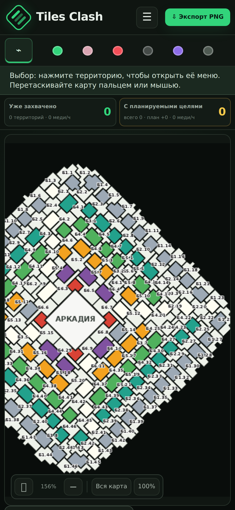

# Tiles Clash Planner

Веб-приложение для планирования атак и совместной работы офицеров в Tiles Survive.



## Быстрый старт

```bash
npm ci
npm run dev:full
```

Приложение откроется на [http://127.0.0.1:4173](http://127.0.0.1:4173). Локальный план можно редактировать без аккаунта; совместные проекты работают через backend.

## Документы

- [Руководство пользователя](docs/USER_GUIDE.md)
- [Разработка, сборка и деплой](DEVELOPMENT.md)
- [Пример конфигурации nginx](deploy/nginx.example.conf)
